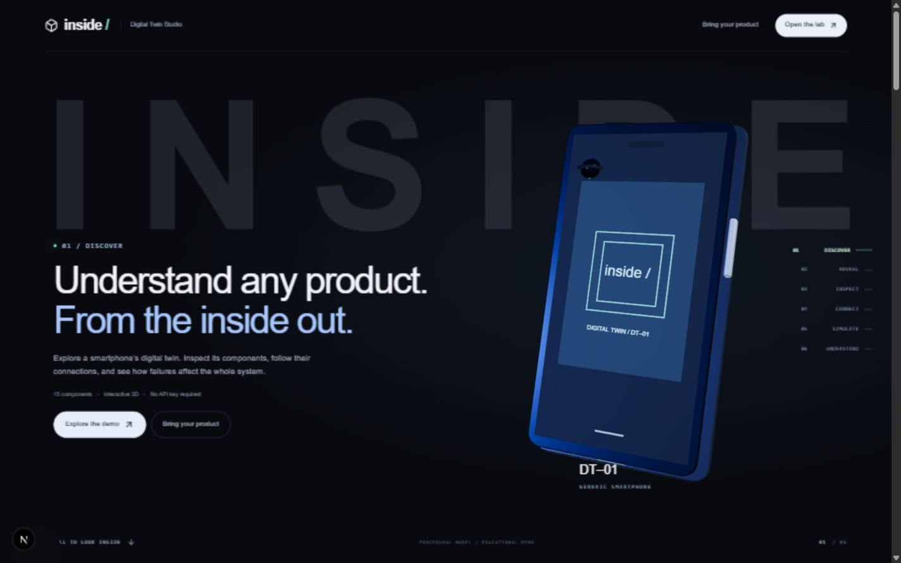
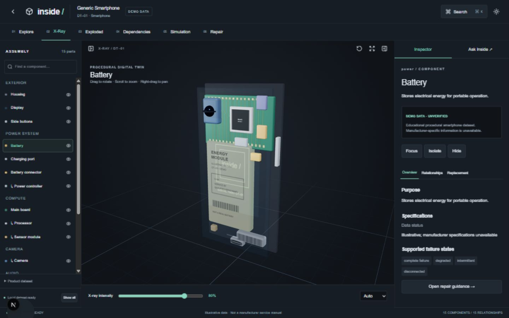

<div align="center">

# OYNX

### Look inside. Understand the connections. Explore what happens next.

An interactive 3D product exploration and simulation studio, built for learning how devices work.

[](https://github.com/SamarVishwakarma2006/OYNX/actions/workflows/ci.yml)


[Quick start](#quick-start) · [Explore the studio](#explore-the-studio) · [Your own models](#bring-your-own-model) · [Development](#development)



</div>

## From a product to its parts

OYNX connects a 3D viewer, component inspector, dependency graph, and qualitative failure simulator in one workspace. Select a part, see what depends on it, and explore how a failure could affect the rest of the device.

Start with the **27-component iPhone schematic demo**, import your own model, or document a device without CAD. The interface also uses the name **Inside**.

**No API key is required for the demo or the local assistant.**

## Explore the studio

| Experience | What you can do |
| --- | --- |
| **Interactive 3D** | Rotate, pan, zoom, focus, isolate, hide parts, and switch camera views. |
| **Exploded assemblies & X-Ray** | Separate schematic components, filter by subsystem, and adjust transparency. |
| **Connected components** | Select parts across the viewer, navigator, inspector, and directed dependency graph. |
| **What-if simulations** | Inject supported failures, inspect affected components, compare a healthy baseline, and undo scenarios. |
| **Repair exploration** | Follow dataset-backed steps, inspect compatibility results, and record repair outcomes. |
| **Local assistant** | Ask contextual questions grounded in the current product and its relationships. Responses are deterministic, not generated by a remote LLM. |
| **Unified Workshop** | Import a model, build a schematic, or reopen saved projects from one place. |
| **Automotive preview** | Rotate an assembled procedural concept car. Automotive exploded views and diagnostics are not implemented yet. |



> The bundled phone pairs an exterior model with educational schematic internals. It is not manufacturer CAD, a live sensor-connected twin, or a validated engineering simulator. Repair content is educational guidance; see the [project disclaimer](DISCLAIMER.md).

## Quick start

Use **Node.js 24** and npm, matching the CI environment.

```bash
git clone https://github.com/SamarVishwakarma2006/OYNX.git
cd OYNX
npm ci
npm run dev
```

Open **[127.0.0.1:3000](http://127.0.0.1:3000)** and choose **Explore the demo** or **Open Workshop**.

To try a complete flow:

1. Open the demo and select **Lithium-ion battery** in the component navigator.
2. Use **Focus**, **Isolate**, **X-Ray**, or **Exploded** to inspect it.
3. Open **Dependencies** to explore its connections.
4. Open **Simulation**, simulate a failure, and compare the healthy baseline.
5. Use **Repair** or **Ask Inside** to explore the available context.

## Bring your own model

The Workshop at `/workshop` offers three starting points:

| Starting point | Input | Result |
| --- | --- | --- |
| **Import a model** | A self-contained GLB, optionally with a parts-list CSV | A locally saved project with meshes mapped to component records |
| **Build without a model** | Device details, observed components, and evidence | An abstract schematic, not a reconstructed CAD model |
| **Open an existing project** | A saved local project or exported JSON backup | A restored workspace ready to explore |

### Import workflow

1. Choose **Import a model** and select a **GLB up to 50 MB**. Convert CAD files to GLB before importing.
2. Optionally add a **CSV up to 1 MB** with a required `name` column and an optional `mesh` column.
3. Map meshes to components manually or use **Use mesh labels as components**. Meshes assigned the same component name move together in exploded view.
4. Choose **Save project**, then open it from the project library.
5. Export a backup to keep a portable copy.

Example parts list; replace the mesh labels with names from your own model:

```csv
name,mesh
Rear cover,Rear_Cover
Display,Front_Glass
Battery,Battery_Cell
```

### Where your work lives

Imported GLB files and mappings are stored in **IndexedDB**; schematic projects use **localStorage**. The import workflow processes files in your browser without an account or server upload.

This is browser-local storage, not a hosted private team workspace. Projects do not automatically sync across devices, and clearing site data can remove them. **Export backups before clearing browser data or moving devices.**

## Development

Built with Next.js App Router, React, TypeScript, Three.js, React Three Fiber, Drei, Zustand, and Zod. Vitest covers core logic; Playwright covers desktop and mobile browser flows.

| Command | Purpose |
| --- | --- |
| `npm run dev` | Start the development server |
| `npm run build` | Create a production build |
| `npm run start` | Serve the production build |
| `npm run typecheck` | Check TypeScript types |
| `npm run lint` | Run ESLint |
| `npm test` | Run unit tests |
| `npm run test:e2e` | Run desktop and mobile browser tests |
| `npm run format` | Format source and test files |

Install the browser before your first end-to-end test run:

```bash
npx playwright install chromium
npm run test:e2e
```

[GitHub Actions](https://github.com/SamarVishwakarma2006/OYNX/actions/workflows/ci.yml) runs type checking, linting, unit tests, a production build, and browser tests. Failed browser runs upload traces in the `browser-test-results` artifact.

The missing-model test deliberately returns a **404** for `intentional-missing-twin.glb` to verify that the procedural fallback remains usable. That fixture is not a production asset.

<details>
<summary><strong>Repository map</strong></summary>

```text
src/
├── app/             Routes: landing, Workshop, repair log, automotive preview
├── components/      Viewer, inspector, graph, assistant, and project builders
├── data/            Bundled product and component definitions
└── lib/             Validation, simulation, state, storage, and model mapping
e2e/                 Playwright browser tests
public/models/       Bundled 3D assets
docs/images/         README previews
.github/workflows/   Continuous integration
```

Start with `src/components/Workspace.tsx` for the studio, `src/components/Workshop.tsx` for project management, or `src/lib/simulation.ts` for failure propagation.

</details>

## Credits & project scope

OYNX is an independent educational project with no manufacturer affiliation. Product names identify the devices being explored.

The iPhone exterior model is credited to **[MajdyModels](https://sketchfab.com/MG990)** under **CC BY 4.0**, with adaptations documented in [ATTRIBUTION.md](ATTRIBUTION.md). Third-party asset terms are separate from application code; see the attribution record and [DISCLAIMER.md](DISCLAIMER.md) for details.
